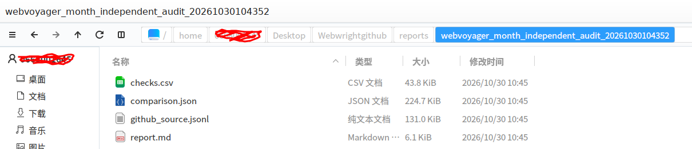

# Historical task-comparison records

This supplement contains four existing local task-comparison files and a file-manager screenshot of their original local modification times.

## Report files

- [report.md](report.md): the historical comparison summary.
- [comparison.json](comparison.json): complete before-and-after definitions for the 49 month-edited tasks and the recorded task-file SHA-256 values.
- [checks.csv](checks.csv): the historical comparison checks for all 615 tasks.
- [github_source.jsonl](github_source.jsonl): the upstream reference retained with the comparison.

## Recorded time sequence

All times below are UTC+08:00.

- The historical report records a comparison time of **October 30, 2026, at 10:43:52**.
- The original four report files currently have local modification times around **10:45:29** on the same day. The file-manager screenshot displays **10:45**.
- Among the 49 edited tasks, the earliest submitted execution-directory timestamp is **11:00:26**, and the earliest saved model-response timestamp is **11:00:41**, both on October 30.
- All 49 corresponding execution-directory and first-response timestamps are later than the recorded report time and those local file-modification times.

The screenshot shows the original files' local modification times. Local account information has been redacted; the filenames and displayed modification times are retained.

The times above are taken from the existing local report, original-file metadata, and saved execution records. They describe the original records, not the time this public copy was prepared.

## Content correspondence

The current google_flight.json SHA-256 exactly matches the value recorded in the historical report. For Booking.json, removing one additional newline and two spaces reproduces the historical SHA-256; all 40 parsed Booking task objects match. The 49 historical edited task definitions also match the published definitions and saved execution inputs.

The original report files have not been changed. These public copies retain their contents except that one absolute local project path in report.md has been replaced with <LOCAL_PROJECT> for privacy.
